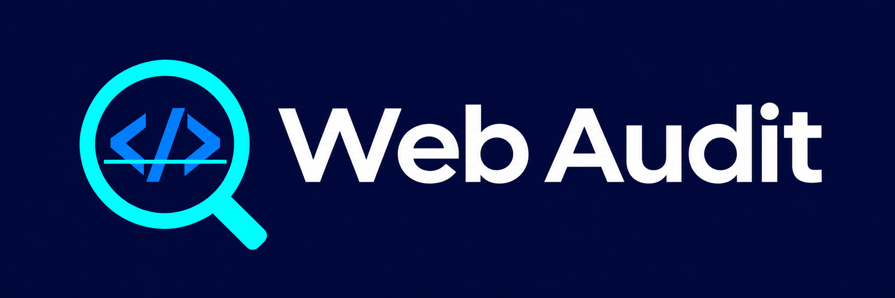
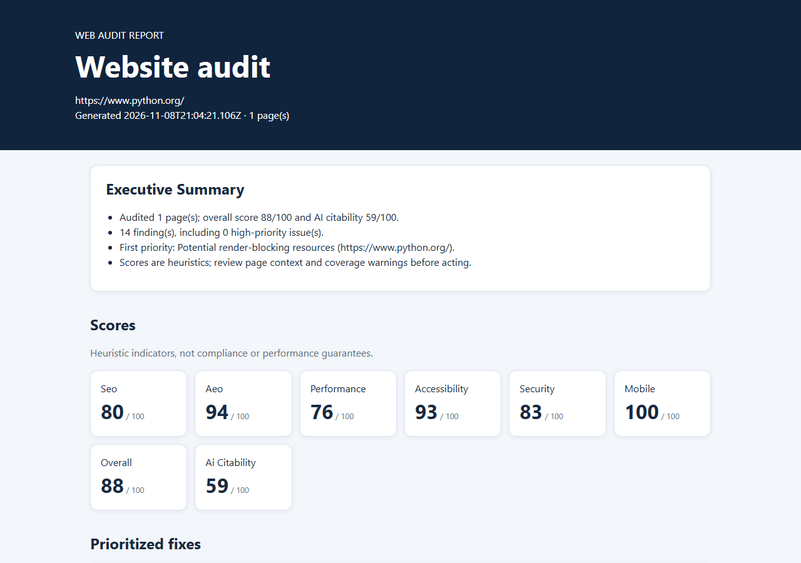

# Web Audit Skill



Web sitelerini gerçek bir Chromium tarayıcısıyla teknik SEO, yapay zekâ yanıtlarına uygunluk (AEO), performans işaretleri, temel erişilebilirlik, güvenlik başlıkları ve mobil görünüm açısından inceleyen açık kaynaklı CLI ve ajan aracıdır.

[English README](README.md)

## Rapor önizlemesi



Görsel, 9 Kasım 2026'da Python.org üzerinde 1.1.1 sürümüyle yapılan gerçek bir çalıştırmadan alınmıştır. Sonuçlar zamana ve çalıştırma koşullarına göre değişir.

## Hızlı başlangıç

1. [Node.js 20 veya üzerini](https://nodejs.org/) kurun.
2. Projeyi indirin ve `package.json` dosyasının bulunduğu klasörde terminal açın.
3. Aşağıdaki komutları çalıştırın. Örnek adresi, denetleme izniniz bulunan bir siteyle değiştirin:

```sh
npm install
npm run build
node dist/cli.js https://example.com --pages 3 --mobile
```

İlk kurulum Chromium'u indirir ve birkaç dakika sürebilir. İşlem bitince `audit-result/report.html` dosyasını tarayıcıda açın; aynı klasörde `report.md` ve `report.json` da bulunur. Paket npm'e yayımlanana kadar `npx web-audit-skill` ile herkese açık kurulum çalışmaz.

## İki siteyi karşılaştırma

```sh
node dist/cli.js https://example.com --compare https://example.org --pages 2 --format both
```

İki site sırayla ve her biri için en fazla belirtilen sayfa sayısıyla taranır. JSON, Markdown ve HTML raporları iki tarafı gösterir. Puan farkı **karşılaştırma sitesi eksi ilk site** olarak hesaplanır. Bulgu farkları kontrol kimliğine göre eşleştirilir; bir bulgunun görünmemesi sorunun çözüldüğünü kanıtlamaz. Bir taraf incelenemezse farklar kullanılamaz ve komut hata koduyla çıkar.

## Sık kullanılan seçenekler

| Seçenek | Açıklama |
| --- | --- |
| `--pages 1-10` | Her site için en fazla sayfa sayısı; varsayılan 3. |
| `--format json\|markdown\|html\|both` | Rapor biçimi; `both` üç dosyayı da üretir. |
| `--output ./audit-result` | Raporların yazılacağı klasör. |
| `--mobile` | Mobil görünümde ek kontrol yapar. |
| `--screenshot` | Tam sayfa ekran görüntüleri kaydeder. |
| `--timeout 30` | Her gezinme/istek için saniye cinsinden zaman aşımı. |

## Ajanlar ve MCP

`SKILL.md` ve `tool.schema.json` dosyalarını kullandığınız ajanın beceri klasöründeki bir `web-audit-skill` dizinine kopyalayabilirsiniz. Ajanınızın güncel beceri keşif yolunu kendi belgelerinden kontrol edin.

Kurulum ve derlemeden sonra `node dist/mcp.js` ile stdio MCP sunucusu başlatılabilir. Claude Desktop gibi istemciler için `mcpServers` yapılandırmasında `node` komutunu ve `dist/mcp.js` dosyasının **mutlak yolunu** kullanın. Örnek JSON ve desteklenen MCP yöntemleri için [İngilizce MCP bölümüne](README.md#mcp-server) bakın. Sunucuyu yalnızca güvenilir istemcilere ve erişimine izin verdiğiniz ağlara açın.

## Skorlar ve sınırlar

- Skorlar otomatik sezgisel göstergelerdir; SEO başarısını, güvenlik veya erişilebilirlik uyumluluğunu garanti etmez. AI citability puanı bir yapay zekâ sisteminin sayfaya atıf yapacağını öngörmez.
- Performans ölçümleri kısa bir sentetik ziyaretten elde edilir; Lighthouse veya gerçek kullanıcı Core Web Vitals verisi değildir. INP ölçülmez.
- Kontrast ve bağlantı denetimleri örneklemeyle sınırlıdır. Geç yüklenen içerik gözden kaçabilir. Mobil tarama istenmez veya tamamlanamazsa mobil skor `null` olur.
- Araç `robots.txt` kurallarına uyar; robotlar dosyasına erişilemiyorsa (404/410 hariç) taramayı durdurur. Bu kurallar siteyi denetleme izni yerine geçmez.
- Araç çalıştığı makinenin erişebildiği ağ adreslerine ulaşabilir. Güvenilmeyen URL'lerle bir hizmet olarak sunmadan önce ağ yalıtımı uygulayın.

## Lisans

MIT. Ayrıntılar ve geliştirici komutları için [LICENSE](LICENSE) ve [İngilizce README](README.md) dosyalarına bakın.
